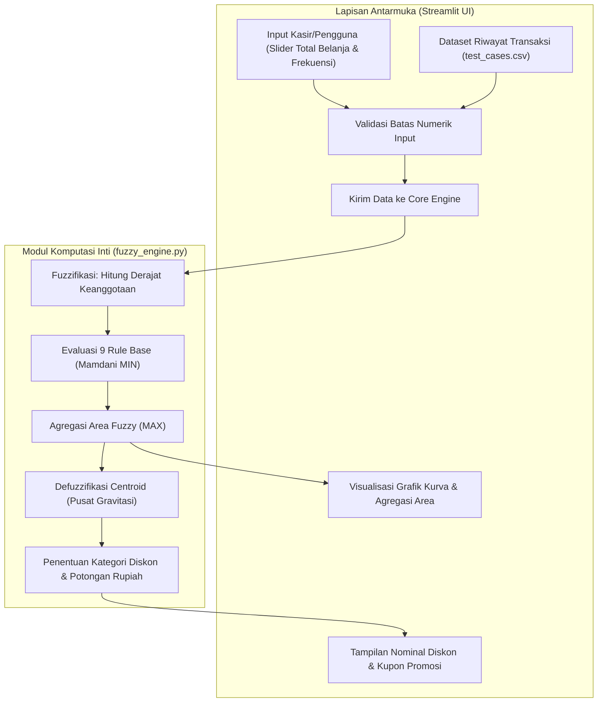

# PROPOSAL PRODUK SISTEM PENDUKUNG KEPUTUSAN FUZZY
## Judul Produk: SmartRetail-Diskon — Sistem Pendukung Keputusan Penentuan Diskon Toko Berbasis Logika Fuzzy Mamdani

**Pengusul:**  
- **Nama Mahasiswa:** Hilmi Farel Arrazak  
- **NIM:** 240306013  
- **Mata Kuliah:** Praktikum Sistem Berbasis Pengetahuan / Kecerdasan Komputasional  
- **Modul:** Modul 3 — Fuzzy pada Permasalahan Nyata (Pertemuan 11)  
- **Tema:** Sistem Rekomendasi & Personalisasi Retail / E-Commerce (Sistem Penentuan Diskon Toko)  

---

### 1. Latar Belakang & Problem Statement

#### 1.1 Masalah Nyata yang Dihadapi
Dalam industri ritel dan *e-commerce*, promosi potongan harga (diskon) merupakan strategi krusial untuk meningkatkan volume penjualan, retensi pelanggan, dan loyalitas konsumen. Namun, manajemen toko sering menghadapi tantangan nyata:
1. **Pemberian Diskon yang Kurang Tepat Sasaran:** Banyak toko menerapkan kebijakan diskon seragam (*flat discount*) atau promosi massal yang menggerus margin keuntungan tanpa meningkatkan retensi konsumen loyal.
2. **Ketiadaan Personalisasi Promosi:** Pelanggan yang sering berbelanja tetapi dengan nominal belanja sedang sering kali tidak mendapatkan apresiasi yang sebanding dengan pembeli baru yang kebetulan melakukan pembelian besar satu kali.
3. **Risiko Kerugian Finansial:** Memberikan diskon terlalu tinggi pada transaksi kecil merugikan toko, sedangkan diskon terlalu rendah pada pelanggan loyal berisiko membuat mereka beralih ke kompetitor (*customer churn*).

#### 1.2 Mengapa Logika Boolean / Aturan Kaku Gagal?
Sistem kasir (*Point of Sale* / POS) konvensional umumnya mengandalkan aturan diskon percabangan kaku (*rigid Boolean if-else*):
- **Masalah Batas Ambang Diskrit (*Sharp Boundary Problem*):** Misalnya aturan menetapkan: *Diskon 20% jika total belanja $\ge$ Rp 500.000*. Seorang pelanggan dengan belanja Rp 499.000 tidak mendapat diskon sama sekali, sedangkan belanja Rp 500.000 langsung mendapat diskon 20%. Selisih Rp 1.000 memicu kesenjangan perlakuan yang membuat pelanggan merasa dirugikan (*buyer dissatisfaction*).
- **Sulit Memadukan Interaksi Multivariabel:** Hubungan antara "Jumlah Pembelian" dan "Frekuensi Kunjungan Belanja" bersifat kontinu. Logika biner (0 atau 1) tidak mampu menangkap nuansa seperti "belanja cukup banyak dan belanja agak sering".
- **Kurang Fleksibel dan Terlalu Kaku:** Logika kaku tidak adaptif terhadap dinamika perilaku belanja konsumen sehari-hari.

Logika Fuzzy (*Fuzzy Logic*) menyelesaikan kelemahan ini dengan memodelkan ketidakpastian (*vagueness*) preferensi manusia, menyediakan transisi diskon yang bertahap dan adil (*smooth gradation*), serta mengoptimalkan margin profit toko sekaligus mempertahankan kepuasan pelanggan.

#### 1.3 Target Pengguna (Stakeholders)
1. **Manajer Toko / Pemilik Bisnis Ritel (*Merchant / Store Manager*):** Mengatur margin promosi secara terukur tanpa khawatir merugi akibat *human error* kasir.
2. **Kasir & Sistem POS (*Point of Sale Integration*):** Sistem POS secara otomatis menghitung besaran diskon yang berhak diterima pelanggan secara instan saat transaksi pembayaran.
3. **Pelanggan Toko (*Customers*):** Merasakan keadilan promosi yang proporsional sesuai riwayat kesetiaan belanja mereka.

---

### 2. Spesifikasi Variabel Sistem

Sistem SmartRetail-Diskon menggunakan dua variabel masukan (*input*) dan satu variabel keluaran (*output*):

```
┌───────────────────────────────────────────┐
│              VARIABEL INPUT               │
├───────────────────────────────────────────┤
│ 1. Jumlah Pembelian (Ribu Rp / Kuota)     │──────┐
│    Semesta: [0, 1000] (0 s.d. Rp 1.000.000)│      │     ┌────────────────────────┐
│                                           │      ├───► │  MESIN INFERENSI FUZZY │ ──► VARIABEL OUTPUT
│ 2. Frekuensi Belanja (kali/bulan)         │      │     │    (Mamdani - MIN/MAX) │     Besar Diskon Toko [0 - 50%]
│    Semesta: [0, 20] kali per bulan        │──────┘     └────────────────────────┘
└───────────────────────────────────────────┘
```

#### 2.1 Variabel Input 1: Jumlah Pembelian
- **Nama Variabel:** Jumlah Pembelian (`jumlah_pembelian`)
- **Satuan:** Ribu Rupiah (skala $0 - 1000$ merepresentasikan transaksi Rp 0 hingga Rp 1.000.000)
- **Semesta Pembicaraan (*Universe of Discourse*):** $U_1 = [0, 1000]$ ribu rupiah
- **Daftar Label Linguistik:**
  1. **Sedikit:** Kurva Trapesium `[0, 0, 150, 350]`
  2. **Sedang:** Kurva Segitiga `[250, 500, 750]`
  3. **Banyak:** Kurva Trapesium `[650, 850, 1000, 1000]`

*Formulasi Matematis:*
$$\mu_{\text{Sedikit}}(x) = \begin{cases} 1, & 0 \le x \le 150 \\ \frac{350 - x}{350 - 150}, & 150 < x < 350 \\ 0, & x \ge 350 \end{cases}$$

$$\mu_{\text{Sedang}}(x) = \begin{cases} 0, & x \le 250 \text{ atau } x \ge 750 \\ \frac{x - 250}{500 - 250}, & 250 < x \le 500 \\ \frac{750 - x}{750 - 500}, & 500 < x < 750 \end{cases}$$

$$\mu_{\text{Banyak}}(x) = \begin{cases} 0, & x \le 650 \\ \frac{x - 650}{850 - 650}, & 650 < x < 850 \\ 1, & 850 \le x \le 1000 \end{cases}$$

---

#### 2.2 Variabel Input 2: Frekuensi Belanja
- **Nama Variabel:** Frekuensi Belanja (`frekuensi_belanja`)
- **Satuan:** Kali transaksi dalam satu bulan
- **Semesta Pembicaraan (*Universe of Discourse*):** $U_2 = [0, 20]$ kali/bulan
- **Daftar Label Linguistik:**
  1. **Jarang:** Kurva Trapesium `[0, 0, 3, 7]`
  2. **Sedang:** Kurva Segitiga `[5, 10, 15]`
  3. **Sering:** Kurva Trapesium `[12, 16, 20, 20]`

*Formulasi Matematis:*
$$\mu_{\text{Jarang}}(y) = \begin{cases} 1, & 0 \le y \le 3 \\ \frac{7 - y}{7 - 3}, & 3 < y < 7 \\ 0, & y \ge 7 \end{cases}$$

$$\mu_{\text{Sedang}}(y) = \begin{cases} 0, & y \le 5 \text{ atau } y \ge 15 \\ \frac{y - 5}{10 - 5}, & 5 < y \le 10 \\ \frac{15 - y}{15 - 10}, & 10 < y < 15 \end{cases}$$

$$\mu_{\text{Sering}}(y) = \begin{cases} 0, & y \le 12 \\ \frac{y - 12}{16 - 12}, & 12 < y < 16 \\ 1, & 16 \le y \le 20 \end{cases}$$

---

#### 2.3 Variabel Output: Besar Diskon Toko
- **Nama Variabel:** Besar Diskon (`besar_diskon`)
- **Satuan:** Persentase potongan harga $(\%)$
- **Semesta Pembicaraan (*Universe of Discourse*):** $U_3 = [0, 50]\%$
- **Daftar Label Linguistik:**
  1. **Kecil:** Kurva Trapesium `[0, 0, 10, 20]` (Diskon minimal untuk apresiasi transaksi dasar)
  2. **Sedang:** Kurva Segitiga `[15, 25, 35]` (Diskon standar pelanggan reguler)
  3. **Besar:** Kurva Trapesium `[30, 40, 50, 50]` (Diskon apresiasi VIP / loyalitas tinggi)

---

### 3. Rancangan Basis Aturan (*Rule Base*)

Rancangan basis aturan mengadopsi 9 aturan kombinatorial penuh ($3 \times 3$) yang telah diuji pada Praktikum Modul 2 (Pertemuan 6 & 8):

| No. Aturan | Kondisi Pembelian | Operator | Kondisi Frekuensi | Konsekuensi Diskon | Rasionalisasi Bisnis Toko |
|:---:|:---:|:---:|:---:|:---:|:---|
| **R1** | Sedikit | AND | Jarang | **Kecil** | Pembeli insidental dengan volume kecil, cukup diskon minimal ($< 15\%$). |
| **R2** | Sedikit | AND | Sedang | **Kecil** | Frekuensi cukup namun belanja sedikit, margin dijaga tetap aman. |
| **R3** | Sedikit | AND | Sering | **Sedang** | Apresiasi loyalitas kunjungan rutin meskipun nominal belanja per transaksi kecil. |
| **R4** | Sedang | AND | Jarang | **Kecil** | Belanja lumayan tapi jarang datang, pancing kembali dengan diskon kecil-sedang. |
| **R5** | Sedang | AND | Sedang | **Sedang** | Profil pelanggan rata-rata yang konsisten, berikan diskon proporsional ($20-30\%$). |
| **R6** | Sedang | AND | Sering | **Besar** | Pelanggan setia yang sering berbelanja dengan nominal moderat, berhak diskon besar. |
| **R7** | Banyak | AND | Jarang | **Sedang** | Pembeli *wholesale* / borongan sesekali, apresiasi volume belanja tinggi. |
| **R8** | Banyak | AND | Sedang | **Besar** | Pembeli belanja banyak dengan kedatangan cukup rutin. |
| **R9** | Banyak | AND | Sering | **Besar** | Pelanggan VIP prioritas tertinggi: volume besar dan sangat sering berkunjung. |

---

### 4. Metode Inferensi & Defuzzifikasi yang Dipilih

#### 4.1 Metode Inferensi: Mamdani (Max-Min)
Sistem ini menggunakan metode inferensi **Mamdani** karena alasan ilmiah berikut:
1. **Representasi Pengetahuan Pakar Ritel yang Intuitif:** Aturan fuzzy Mamdani memiliki konsekuen linguistik (*Kecil, Sedang, Besar*) yang sangat mudah dipahami dan divalidasi oleh manajer penjualan (*sales manager*).
2. **Kesesuaian dengan Permasalahan Diskon Bertahap:** Menghasilkan bentuk agregasi ruang solusi yang kontinu, mencerminkan perpaduan halus antara insentif frekuensi belanja dan insentif nominal belanja.
3. **Formulasi Komputasi:**
   - **T-Norm (AND / Operator MIN):** $\alpha_i = \min(\mu_{\text{Pembelian}}(x), \mu_{\text{Frekuensi}}(y))$
   - **Implikasi Fuzzy:** $\mu_{R_i}(z) = \min(\alpha_i, \mu_{\text{Diskon}_i}(z))$
   - **S-Norm (Agregasi MAX):** $\mu_{\text{agregasi}}(z) = \max_{i=1}^{9}(\mu_{R_i}(z))$

#### 4.2 Metode Defuzzifikasi: Centroid (Center of Gravity / COG)
Penentuan nilai crisp persentase diskon dilakukan dengan menghitung titik pusat gravitasi kurva agregasi:
$$z^* = \frac{\int_{0}^{50} z \cdot \mu_{\text{agregasi}}(z) \, dz}{\int_{0}^{50} \mu_{\text{agregasi}}(z) \, dz} \approx \frac{\sum_{j=1}^{N} z_j \cdot \mu_{\text{agregasi}}(z_j)}{\sum_{j=1}^{N} \mu_{\text{agregasi}}(z_j)}$$

**Keunggulan Centroid untuk Diskon Toko:**
- Nilai persentase diskon bergerak secara mulus tanpa lompatan ekstrem yang dapat menimbulkan komplain dari pembeli di ambang batas.
- Terbukti paling stabil dan representatif dalam studi komparasi defuzzifikasi Modul 2.

---

### 5. Rencana Arsitektur Perangkat Lunak

Sistem dirancang dengan arsitektur modular (*Separation of Concerns*) yang memisahkan logika komputasi inti (*Core Engine*) dengan antarmuka pengguna (*Streamlit UI*):

```
Modul-3/
├── Proposal_Produk_240306013.md       # Dokumen spesifikasi produk & proposal diskon toko
├── src/
│   ├── __init__.py                    # Inisialisasi paket modul Python
│   ├── fuzzy_engine.py                # Core Engine: Fuzzifikasi, 9 Aturan Mamdani, Defuzzifikasi Centroid
│   └── app.py                         # Antarmuka Pengguna: Streamlit Web Dashboard & Kalkulator Diskon
└── data/
    └── test_cases.csv                 # Dataset uji transaksi belanja pelanggan untuk validasi
```

#### 5.1 Diagram Alur Data (*Data Flow Diagram* / Mermaid)



#### 5.2 Rencana Fitur Antarmuka Pengguna (Streamlit)
1. **Interactive POS Calculator:** Input dinamis total belanja (Rp) dan frekuensi belanja pelanggan (kali/bulan).
2. **Kalkulator Nominal Otomatis:** Menghitung langsung nominal rupiah yang dihemat pembeli serta total tagihan bersih setelah diskon.
3. **Visualisasi Grafik Keanggotaan & Agregasi:** Menampilkan kurva fungsi keanggotaan dan arsiran area potongan implikasi Mamdani.
4. **Batch Evaluation Mode:** Memproses dataset CSV berisi ratusan data pelanggan dan mengekspor hasilnya kembali ke format CSV.

---

### 6. Analisis Kebutuhan Sistem

#### 6.1 Kebutuhan Fungsional (*Functional Requirements*)
- **FR-01:** Menerima masukan numerik nominal belanja ($0 - 1.000$ ribu Rp) dan frekuensi transaksi ($0 - 20$ kali/bulan).
- **FR-02:** Melakukan validasi *clamping* agar nilai masukan tidak melebihi semesta pembicaraan.
- **FR-03:** Menghitung derajat keanggotaan himpunan Sedikit/Sedang/Banyak dan Jarang/Sedang/Sering.
- **FR-04:** Mengeksekusi 9 aturan Mamdani menggunakan operator MIN dan agregasi MAX.
- **FR-05:** Menghasilkan persentase diskon crisp menggunakan metode Centroid ($0 - 50\%$).
- **FR-06:** Menyajikan grafik interaktif area agregasi fuzzy dan posisi nilai defuzzifikasi.
- **FR-07:** Mendukung pemrosesan otomatis file dataset `test_cases.csv`.

#### 6.2 Kebutuhan Non-Fungsional (*Non-Functional Requirements*)
- **NFR-01 (Waktu Respon Komputasi):** Waktu inferensi per transaksi $< 0.05$ detik agar tidak menghambat antrean kasir.
- **NFR-02 (Modularitas Kode):** `fuzzy_engine.py` murni modular tanpa dependensi antarmuka GUI/Streamlit.
- **NFR-03 (Kemudahan Penggunaan / Usability):** Antarmuka responsif dan ramah pengguna kasir dengan slider dan ringkasan angka jelas.
- **NFR-04 (Maintainability):** Kode terdokumentasi rapi sesuai standar PEP 8.
